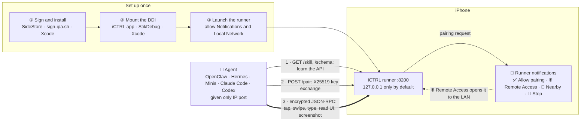

# iCTRL

**AI-friendly iOS automation service, built on XCUITest.**

> [!WARNING]
> **For automated testing and research only.** iCTRL hands full control of a
> phone (taps, text input, screen contents, every installed app) to whoever
> holds a paired key. Any automation like this can be hijacked or misused:
> a leaked key, a client you shouldn't have approved, or an agent acting on
> instructions it picked up along the way. **Weigh the risks before you use it:**
> - Run it only on devices you own and accounts you are entitled to automate.
> - Approve only the pairing requests you started.
> - Leave remote access off unless you need it, and stop the server when you
>   are done.
> - Don't leave an agent unsupervised around payments, messages or anything
>   that can't be undone.
>
> You are responsible for how you use it, including compliance with the terms
> of the apps you automate.

iCTRL turns an iPhone into a controllable automation endpoint. It runs a
long-lived XCUITest runner that exposes a **JSON-RPC 2.0 API over HTTP** (default
port `8200`), so an AI agent — or any HTTP client — can drive the device: tap,
swipe, type, read the UI tree, take screenshots, launch apps, open URLs, and more.

Unlike a raw XCUITest script, iCTRL is designed to be **discovered and driven by a
model**: `GET /skill` serves a complete operating manual and `GET /schema`
documents every method with its parameters, so an agent can learn the API at
runtime and call it correctly without prior knowledge.

**Works with any agent.** The JSON-RPC API and the skill are built in and
progressively discoverable: an agent starts from the manual and drills into the
schema only as it needs to. Any agent that can make HTTP requests can use it,
such as OpenClaw, Hermes, Minis, Claude Code or Codex. All it needs is the
phone's IP address and port; these agents usually explore the endpoint and
install the skill themselves to learn how to drive the phone. Minis is
additionally optimized for iCTRL, so it carries out interactions on the phone
faster.

**Hand it to your agent in one sentence.** Once the runner is up (with remote
access enabled, if the agent isn't on the phone), tell your agent:

> *"My iPhone is running iCTRL at 192.168.1.20:8200 — figure out how to drive it."*

It finds the manual at `GET /skill` and the method list at `GET /schema`,
downloads a client from the device, and asks to pair. Approve the pairing
notification on the phone, and from there it works out the rest.



An agent on the phone itself, such as Minis, reaches the runner on
`127.0.0.1`. An agent on another machine needs **🌐 Remote Access** turned on
and the same Wi-Fi network.

- **Bundle ID:** `com.openminis.ictrl`
- **Transport:** JSON-RPC 2.0 over HTTP, port `8200`
- **Auth:** encrypted envelope (X25519 pairing → HMAC-SHA256 sealed requests)
- **Shipped as two IPAs:** `iCTRLUITests-Runner.ipa` (the automation engine —
  **required, and the one that must be running**) + `iCTRL.ipa` (the
  companion app — **optional**, see [The iCTRL app](#the-ictrl-app-optional))
- **Needs:** a way to sign the IPA (free Apple ID via SideStore, or a paid
  account) and the Developer Disk Image mounted — see
  [Installation](#before-you-start--two-things-you-need)

## The iCTRL app (optional)

The runner does all the automation and runs on its own. `iCTRL.ipa` is a
companion app for doing the surrounding chores on the phone itself:

- **Mount the Developer Disk Image without a Mac**, and re-mount it after a
  reboot in one tap ([Option 3](#option-3--the-ictrl-app)). Pairing files can
  be picked in the app or shared to iCTRL from Files, Mail, AirDrop or a chat.
- **Start and stop the runner**, and see whether it is running and which
  version.
- **Visibility:** see and switch who can reach the runner — 🟢 this device
  only, 🟡 LAN, or 🟡 LAN + nearby (AWDL).
- **Authorized clients:** every computer, agent and browser holding a key,
  where each last connected from (this device / USB, LAN, nearby, VPN), and
  revoking any of them.
- **Runner logs, live**, with pause, refresh and filter.

The app pairs with the runner once like any client (one Allow in the runner's
notification). You can skip it if you mount the DDI with Xcode or StikDebug and
manage the runner from its notification or a computer — with a free Apple ID's
three-app limit, installing StikDebug *or* the iCTRL app is enough.

## Features

**Built for AI agents**
- **Self-describing.** The device serves its own operating manual (`GET /skill`,
  under 15K characters, most important rules first) and a full method schema
  (`GET /schema`). An agent given only the address learns the rest by itself.
- **Responses that steer.** Every result carries a `hint`, and every error says
  what to do next. A `ref` re-resolves the live element at tap time;
  `visibility` and `alternatives` flag look-alikes; scrolls report whether they
  moved and where you are in the list.
- **Knows the apps on the phone.** `resolve_app` turns an app name into a bundle
  id offline and remembers which apps actually opened on this device, even
  where iOS refuses to list installed apps.

**Fast**
- **~280ms taps.** Synthesized touch events with no wait-for-idle.
- **The visible screen in under 1s**, even on long-scrolled feeds (p50 416ms
  across 8 apps). Snapshots are bounded on the device, so the app never
  serializes thousands of off-screen rows.
- **Element lookups in ~0.3–1s**, on the same bounded walk.

**Sees what the accessibility tree can't**
- **On-device OCR** (`screen_text`, Vision) returns text with tappable
  coordinates. `page_source` measures its own coverage and falls back to it
  automatically when the tree comes back thin (web views, custom-drawn text).
- **Feedback on coordinate taps.** A tap by coordinates reports which element it
  hit, or warns that it landed on empty space.

**Robust in long, unattended sessions**
- **Never queries an app that has left the screen.** Such calls are refused in
  milliseconds instead of stalling for seconds. System alerts and the home
  screen are recognised as the foreground.
- **Diagnosable while stuck.** `logs`, `config` and `reset` keep answering while
  UI calls hang. A circuit breaker stops queueing behind a stuck call, timeouts
  name the call holding the queue, and logs survive a crash.

**Secure by default**
- **Pairing is approved on the phone.** Every request is then encrypted and
  authenticated: X25519 key exchange, a per-request HMAC-SHA256 envelope, and
  replay and clock-skew protection.
- **Local only until you say otherwise.** Remote access is off by default, and
  an unused key expires after 30 days. Nearby discovery is a separate, explicit
  step, and only this device can switch it on.

**No Mac required**
- Install with a **free Apple ID** through SideStore, and mount the Developer
  Disk Image **on the device** with the iCTRL app or StikDebug.
- **No UI to look after.** Long-press the runner's notifications to approve
  pairing, toggle remote access or stop the server.
- **Clients come from the device:** a Python client and a pure-C static CLI for
  agents in on-device sandboxes such as Minis.
- **No address to type:** with nearby discovery on, clients find the phone on
  the LAN, or from a Mac over Apple peer-to-peer Wi-Fi with no shared network
  at all. One key per device works over USB, the LAN and nearby.

**Also included:**
- live H.264 screen stream (`GET /stream`) and a browser control page (`GET /remote`)
  that also works from another phone: full screen, a floating quick-control ball,
  and Add to Home Screen for a view with no browser bars;
- deep links via `open_url`;
- `home`, `lock`, `unlock`;
- iOS 16 and later.

## How it works

iCTRL is a UITest target that never stops. On launch it starts an `NWListener`
HTTP server and holds the run loop open (WebDriverAgent-style: block on
`distantFuture`, near-zero idle CPU). Every RPC maps to an XCUITest action
executed against the foreground app or a bound target app.

```
AI agent / curl ──HTTP JSON-RPC──▶ iCTRL runner (XCUITest) ──▶ iOS UI
```

Interactions are synthesized with `XCSynthesizedEventRecord` / `XCPointerEventPath`,
which bypasses XCUITest's quiescence waits.

## How it differs from WebDriverAgent

[WebDriverAgent](https://github.com/appium/WebDriverAgent) (WDA) is Appium's
iOS driver: a heavyweight server built for test suites, usually driven from a
Mac. iCTRL borrows several of WDA's proven mechanisms: the never-ending XCUITest
runner, the `distantFuture` run loop and its app-activation handling. Its aim is
different, though. iCTRL is a phone an **AI agent** operates in real time,
often from the phone itself, so the work went into speed, robustness and making
every response usable by a model.

| | WebDriverAgent (estimated from its source and defaults, not measured) | iCTRL |
|---|---|---|
| **Taps** | `XCUIElement`/`XCUICoordinate.tap`, which waits for the app to go idle before and after (`waitForIdleTimeout` 10s by default). *Estimated* **~0.5–1s** per tap | Synthesized touch events with no idle waits: **~280ms median** (measured) |
| **Reading long lists** | A snapshot limited to depth 50 (`snapshotMaxDepth`). That caps nesting but not breadth, so every off-screen row of a long feed is still serialized. *Estimated* **several seconds** per read on a long-scrolled X timeline, sometimes long enough to time out | Snapshots bounded in depth *and* breadth on the device, keeping only what is on screen: **p50 416ms / p90 593ms across 8 apps, never over 1s** (measured). Element lookups use the same bounded walk (~0.3–1s) |
| **When the tree is empty** (web views, custom-drawn text, sparse recycling lists) | — | On-device **Vision OCR** (`screen_text`, ~0.5s) returns text with tappable point coordinates. `page_source` measures its own coverage and falls back to OCR by itself |
| **Built for** | Test frameworks (WebDriver/Appium protocol) | AI agents. The device serves its own manual (`GET /skill`) and schema (`GET /schema`). Every response carries a `hint`, and errors say what to do next. `ref`s re-resolve the live element; `visibility`/`alternatives` flag look-alikes; scrolls report whether they moved and where you are |
| **Security** | Plain HTTP, no authentication | Pairing must be approved on the phone. Every request is encrypted and authenticated (X25519 pairing, per-request HMAC-SHA256 envelope, replay and clock-skew protection) |
| **Clients** | Appium / WebDriver client libraries | Downloaded straight from the device: a Python client, and a **pure-C static CLI** (aarch64-musl, no runtime dependencies, ~9x faster to start than Python) for agents in on-device sandboxes like Minis |
| **Needs a Mac** | To build, sign and usually to drive | Only optionally. The DDI can be mounted on the device, signing can go through SideStore, and the runner serves on its own |
| **When things go wrong** | — | Diagnostics stay up while UI calls are stuck (`logs`, `config`, `reset`). A circuit breaker stops queueing behind a stuck call, and timeouts name the call holding the queue. Logs survive a crash |

The runner IPA is about 1MB.

---

# Installation

## Before you start — two things you need

iCTRL's automation engine is an XCUITest runner, and iOS only runs one when two
conditions hold. Sort out both before anything else:

**1. A way to sign and install the IPA.** Both a free Apple ID and a paid
developer account work:

| You have | How |
|---|---|
| Free Apple ID | The **latest SideStore** signs and installs it → [A](#a-free-apple-id--sidestore) |
| Paid developer account | Sign with [`Scripts/sign-ipa.sh`](Scripts/sign-ipa.sh) → [B](#b-paid-developer-account--scriptssign-ipash), or run from Xcode → [C](#c-paid-developer-account--xcode) |

The runner can't be signed with just any tool. Its IPA contains a nested test
bundle, `PlugIns/iCTRLUITests.xctest`, which needs its own signature. That
bundle has to be signed first, from the inside out, and it has to carry the
runner's bundle id. Most signers only recurse into `.framework`/`.appex` and
leave the `.xctest` alone. The package then installs fine and **crashes the
moment it launches**. Use one of the routes above, which handle this.

**2. The Developer Disk Image (DDI) mounted.** XCUITest talks to the
`testmanagerd` daemon, and that daemon only exists while a DDI is mounted. A
reboot unmounts it, so remount after every restart:

| You have | How |
|---|---|
| A Mac with Xcode | Connect the phone once; Xcode mounts it automatically → [Option 1](#option-1--xcode) |
| No Mac | [StikDebug](#option-2--stikdebug) **or** the [iCTRL app](#option-3--the-ictrl-app) mounts it on the device. You need only one; with a free Apple ID there is room for only one ([why](#a-free-apple-id--sidestore)) |

Once both are in place: [launch the runner](#step-3--launch-the-runner).

---

## Step 1 — Sign & install

Enable **Developer Mode** first (iOS 16+: **Settings → Privacy & Security →
Developer Mode**, then restart). Development-signed apps won't open without it.

### A. Free Apple ID — SideStore

A free account issues 7-day certificates, and SideStore re-signs your apps
before they expire.

1. **Install SideStore** with [iLoader](https://github.com/nab138/iLoader) on
   your computer. Connect the phone over USB, sign in with your Apple ID, and
   install SideStore. iLoader also sets up the pairing file SideStore needs.
2. **Install [LocalDevVPN](https://apps.apple.com/app/localdevvpn/id6755608044)**
   from the App Store and connect it. SideStore installs and refreshes apps
   through it.
3. **Use the latest SideStore release.** Older builds signed with `ldid`, which
   skips the `.xctest`, so the runner installs and then crashes on launch.
4. In SideStore: **My Apps → +** → pick `iCTRLUITests-Runner.ipa`.
   Optionally install `iCTRL.ipa` the same way (see the app limit below).
5. On the device: **Settings → General → VPN & Device Management** → trust
   your Apple ID's developer certificate.

> **Free-account limits.**
> - Certificates last **7 days**. Open SideStore and refresh before they
>   expire (it can refresh in the background while LocalDevVPN is connected).
>   Otherwise the runner stops launching.
> - A free account can have at most **3 sideloaded apps** active at once, and
>   SideStore itself counts as one. The limit is counted by the device, so a
>   second Apple ID doesn't raise it. With the runner that leaves room for
>   **one** more, which is how you mount the DDI without a Mac. Pick **either**
>   the iCTRL app **or** StikDebug:
>   - **iCTRL app** if you don't use StikDebug already. It is built for this:
>     it shows whether the DDI is mounted, remounts in one tap, and starts the
>     runner.
>   - **StikDebug** if you already have it for JIT. It mounts the DDI just as
>     well, and you don't need the iCTRL app at all.
>
>   If you mount with Xcode on a Mac instead, you need neither. SideStore plus
>   the runner is enough.

### B. Paid developer account — `Scripts/sign-ipa.sh`

You need three things:
- an **Apple Development** certificate in your keychain;
- a **development** provisioning profile that includes your device. A wildcard
  `TEAMID.*` App ID covers both packages. Opening the project in Xcode once
  with automatic signing downloads one.
- a Mac, because the script uses Apple's `codesign`.

```bash
Scripts/sign-ipa.sh -i iCTRLUITests-Runner.ipa
# → iCTRLUITests-Runner-signed.ipa
```

With no other options, the script picks everything itself:

| Option | Default |
|---|---|
| `-t TEAMID` | `$DEVELOPMENT_TEAM`, then `Config/Local.xcconfig`, then the Xcode project's build settings |
| `-p PROFILE` | the installed development profile for that team that covers the package's bundle id. An exact App ID wins over a wildcard, then the one that expires last. `-p` takes a `.mobileprovision` path, a profile UUID or a profile name. |
| `-s IDENTITY` | the keychain signing identity whose certificate is in that profile. `-s` takes a name or SHA-1 (`security find-identity -v -p codesigning`). |
| `-o OUT` | `<input>-signed.ipa` |

It checks up front that the profile and identity actually belong together.
This is matched on certificate hashes, because the ID in an identity's name is
the certificate holder's, not the team's. A mismatch is reported before
anything is signed. Without this check, iOS would reject the install with an
error that never mentions the profile.

The script does four things, in this order:
1. sets the `.xctest`'s bundle id to the runner's;
2. signs from the inside out: loose dylibs → frameworks → `PlugIns/*` → the app;
3. writes the entitlements a test runner needs, including `get-task-allow`;
4. verifies every nested binary before it repacks.

It refuses a distribution profile, because a runner signed with one installs
but never launches. The same command signs `iCTRL.ipa`.

Install the signed IPA with any of:
- Xcode's **Devices and Simulators → Installed Apps → +**;
- Apple Configurator;
- `ideviceinstaller -i <ipa>`.

<details>
<summary>What the script is working with</summary>

```
iCTRLUITests-Runner.app/
├── iCTRLUITests-Runner          ← host binary
├── Frameworks/
│   └── libXCTCompatShim.dylib   ← must be signed, or dyld rejects it
└── PlugIns/
    └── iCTRLUITests.xctest/     ← signed FIRST, separately, with the runner's id
        └── iCTRLUITests
```

`ldid` in particular will not sign the `.xctest`: it only recurses into
`.framework` and `.appex`. An unsigned dylib fails at launch with *"mapped file
has no cdhash"*, which looks nothing like a signing problem. That is why the
script verifies each nested binary before it repacks.
</details>

### C. Paid developer account — Xcode

The simplest route if you have the source and a Mac. It also takes care of
[the DDI](#option-1--xcode).

```bash
brew install xcodegen
make build        # fetches dependencies, writes your signing config, generates the project
open iCTRL.xcodeproj
```

1. Select the **iCTRL** scheme and your device.
2. **Product → Test** (⌘U).

Your team and bundle-id prefix come from `Config/Local.xcconfig` (see
[Building](#building)). Change them there rather than under *Signing &
Capabilities*: the project is regenerated from `project.yml`, which would undo
edits made in Xcode.

Xcode builds, signs, installs and launches the runner. The runner keeps running
after the test session detaches, so you can quit Xcode and keep using the API.

---

## Step 2 — Mount the DDI

The image does **not survive a reboot**. After every restart, remount it with
any one of the options below, then launch the runner again.

### Option 1 — Xcode

Connect the phone to a Mac running Xcode, over USB or the same network. Wait
until **Window → Devices and Simulators** shows the device as ready. Xcode
mounts the DDI on its own when it prepares the device for development, and the
image stays mounted until the next reboot. You can disconnect afterwards.

### Option 2 — StikDebug

[StikDebug](https://github.com/StikDebug/StikDebug) mounts the DDI on the
device itself, with no computer involved after setup:

1. Sideload StikDebug (for example with SideStore) and install
   [LocalDevVPN](https://apps.apple.com/app/localdevvpn/id6755608044) from the
   App Store.
2. Give StikDebug a pairing file, following its own setup guide. iLoader can
   provide one.
3. Connect LocalDevVPN, then open StikDebug. It mounts the Developer Disk Image
   by itself at launch. Once it reports the image as mounted, you're done.

### Option 3 — the iCTRL app

`iCTRL.ipa` (the host app) includes the same kind of on-device mounter. It is
signed and installed like the runner ([Step 1](#step-1--sign--install)). Then:

**Settings → Runtime requirements → Mount without a Mac…**, and follow the
four steps on that screen:

1. **Start LocalDevVPN.** Tap *Open LocalDevVPN & connect*. The app sends you
   there and brings you back.
2. **Import a RemotePairing file.** StikDebug's `pairingFile.plist` works as
   is. iLoader, or [idevice_pair](https://github.com/jkcoxson/idevice_pair) on
   a computer (choose *Remote pairing*), can also create one. Send it over
   AirDrop, Files or iCloud. If the picker can't reach the file, share it to
   iCTRL from the app that has it; iCTRL confirms once it is stored. A
   lockdown pairing file (from `idevicepair pair`, or SideStore's
   `ALTPairingFile.mobiledevicepairing`) is refused: it cannot open the
   tunnel the mount uses.
3. **Download image files.** About 100 MB, downloaded once and reused.
4. **Mount Developer Disk Image.**

Two things this option needs:
- **Wi-Fi.** The tunnel runs over the local network interface, which cellular
  doesn't provide.
- **Internet on the first mount.** Apple has to issue a signing ticket for this
  specific device.

When iCTRL shows *Mounted*, the runner can launch. After a reboot, use
**Re-mount…** on the same screen.

---

## Step 3 — Launch the runner

Tap **iCTRLUITests-Runner** on the Home Screen, or **Start Server** in the
iCTRL app.

**The first time, iOS asks for three things. Answer all three:**
1. **Your device passcode.** iOS may ask for it when a UI-automation session
   starts; enter it. This can come back after a reboot.
2. **Notifications → Allow.** The runner has no screen of its own, and its
   notifications are how you control it (below). If you deny this, you can't
   approve a pairing request. Fix it later under **Settings → Notifications →
   iCTRLUITests-Runner**.
3. **Local Network → Allow.** The runner asks right after it starts. Without
   it the self-check and nearby discovery fail (clients connecting in over the
   LAN may still work, which hides the problem). If you denied it, switch on
   **iCTRLUITests-Runner** under **Settings → Privacy & Security → Local
   Network**; the iCTRL app warns when it is missing.

### Controlling iCTRL from its notification

An XCUITest runner can't show an interface: it opens, starts the server and
moves to the background. Everything you'd expect on a settings screen is in its
notifications instead. **Long-press a notification** (or swipe left → *View*)
to get its menu:

| Notification | Menu |
|---|---|
| **🟢 iCTRL Server Ready** — always present while the server runs; refreshes silently every 5 minutes. Its first line says who can reach the phone: **🔒 This device only**, **🌐 LAN reachable**, **📡 Nearby discoverable**, or why nearby isn't ready yet (e.g. *turn on Wi-Fi*, *allow Local Network*) | **🌐 Enable Remote Access** / **🔒 Disable Remote Access**, **📡 Enable Nearby Discovery** / **📴 Disable Nearby Discovery** (with remote access on), **🛑 Stop Server** |
| **Pairing request** from a client | **✅ Allow** / **⛔️ Deny** |
| **⏹️ iCTRL Server Stopped** | **📋 Copy Logs** |

- **Remote access is off by default.** The server only answers on the device
  itself (`127.0.0.1`), e.g. an agent running in an on-device sandbox. To drive
  the phone from another machine, choose **🌐 Enable Remote Access** first.
- **Every action except Deny needs the phone unlocked** (Allow, the
  remote-access and nearby switches, Stop Server, Copy Logs). iOS asks for
  Face ID / the passcode if it isn't. Copied logs are redacted.
- Any app can open `ictrl://stop`, so it doesn't stop the server by itself: it
  posts a **Stop iCTRL?** notification to confirm on the phone. The iCTRL app,
  once paired with the runner, stops it over the encrypted channel instead.
- To start again after **Stop Server**, open the runner (or tap **Start
  Server** in the iCTRL app) again.
- The iCTRL app shows the same switch as a **Visibility** menu.

### Who can reach it: visibility

| Setting | Reachable from | Announced (Bonjour) |
|---|---|---|
| 🔒 **This device only** (default) | apps on the phone, a computer over USB | nowhere |
| 🌐 **LAN** (remote access on) | anyone on the same network who knows the address | nowhere |
| 📡 **LAN + nearby** (nearby discovery on) | the above, plus nearby Apple devices over peer-to-peer Wi-Fi (AWDL) | on the LAN and over AWDL |

Every client still needs a key approved on the phone; visibility only decides
who can ask. Nearby discovery can be switched **on** only from the phone itself
(its notification, the iCTRL app, or a computer over USB); anyone with a key
can switch it off.

### Finding the device: nearby discovery

With **📡 Nearby discovery** on, a client needs no address:

```bash
python3 ictrl_rpc.py scan                        # lists the phone: LAN and/or nearby (AWDL)
python3 ictrl_rpc.py --nearby "iPhone 15 (7f3a)" call device_info   # or an id prefix: --nearby 7f3a
```

- **On the LAN** from any OS (macOS uses Bonjour; elsewhere the Python client
  sends its own mDNS query).
- **Over AWDL** from a Mac, with no shared network: the phone only needs Wi-Fi
  switched **on**, not joined to anything. This needs macOS (the Python client,
  or the C CLI built on macOS).
- The phone is advertised as its model plus a short id, e.g. *iPhone 15
  (7f3a)*; a paired client can rename it with `config{device_name}`. On the LAN
  iOS also announces the phone's own host name, which often contains its
  owner's name.
- A phone whose screen is off may stop being discoverable over AWDL, as with
  AirDrop. Wake it if it disappears.

### Check that it's up

With remote access enabled, from another machine on the same Wi-Fi:

```bash
curl http://<device-ip>:8200/schema
```

If that returns a JSON document, the runner is up.

**If the runner opens and closes immediately:**
- The DDI isn't mounted, usually because the phone rebooted. Remount it
  ([Step 2](#step-2--mount-the-ddi)).
- The `.xctest` wasn't signed. Re-sign with a route from
  [Step 1](#step-1--sign--install).
- The free certificate expired. Refresh in SideStore.

**If `curl` can't connect but the runner is running:** remote access is still
off (see above), Local Network access was denied (**Settings → Privacy &
Security → Local Network**), or the phone is on cellular. A LAN client can only
reach it over Wi-Fi.

---

## Quick start

Every `/rpc` body is an **encrypted envelope**; there is no plaintext path. Don't
hand-roll the crypto — download a client from the device itself:

```bash
# Fetch the reference client (unauthenticated)
curl -o ictrl_rpc.py http://<device-ip>:8200/skill/clients/python

# Pair once — long-press the pairing notification on the phone → ✅ Allow
# (blocks up to 60s). Standard library only, no packages to install.
python3 ictrl_rpc.py --host <device-ip>:8200 pair

# Drive it
python3 ictrl_rpc.py --host <device-ip>:8200 call device_info
python3 ictrl_rpc.py --host <device-ip>:8200 call tap '{"x":100,"y":200}'
```

No address at hand? Turn on nearby discovery and use `scan` / `--nearby`
([above](#finding-the-device-nearby-discovery)). Keys are stored per device in
`~/.ictrl/token.json`, so a phone paired once works over USB, the LAN and nearby
without pairing again.

There is also a static aarch64-musl CLI at `/skill/clients/cli` for sandboxes
with no Python.

**`GET /skill`** returns the full operating manual in Markdown, so you don't need
to brief an agent yourself. Give it the address ("*My iPhone is running iCTRL at
192.168.1.20:8200 — figure out how to drive it.*") and it will read the manual
and drive the device from there.

## API surface

All methods are JSON-RPC 2.0 (`POST /rpc`). Highlights:

| Group | Methods |
|---|---|
| **Touch** | `tap`, `double_tap`, `long_press`, `tap_element`, `find_and_tap`, `swipe`, `scroll`, `scroll_to_element`, `drag`, `page` |
| **Text** | `type` (with `submit`/`clear`), `clear_text` |
| **Read** | `screenshot`, `page_source`, `find_element`, `screen_text` (Vision OCR) |
| **Apps** | `launch_app`, `activate_app`, `terminate_app`, `list_apps`, `resolve_app`, `open_url` |
| **Device** | `device_info`, `home`, `lock`, `unlock`, `is_locked`, `wait` |
| **Server** | `config` (remote access, `nearby_discovery`, `device_name`, sessions and revocation, `stop_server`), `reset`, `stream_ticket` |

### Continuous single-finger paths

`drag` accepts an optional `points` array to follow a polyline without lifting
between waypoints. This supports drawing and dragging around corners. It is a
single finger, not simultaneous multi-touch. Existing endpoint/ref calls are
unchanged.

```json
{"method":"drag","params":{"points":[{"x":50,"y":200},{"x":150,"y":200},{"x":150,"y":300}],"duration":1.2}}
```

Coordinates are screen **points**, not screenshot pixels. Supply 2–64 finite,
nonnegative, on-screen `{x,y}` points. Do not combine `points` with
`from_x/from_y/to_x/to_y` or `from_ref/to_ref`. Total `duration` is 0.1–10 seconds
(default 1), divided equally between segments; repeating a waypoint holds the
finger there for that segment. All waypoints are validated before any touch is
injected. The finger presses once at the first point and lifts once after the
last point. The normal challenge check uses the actual path start, and long
paths receive enough RPC time for the gesture and settle check to finish.

Run the validation/timing tests on a Mac with the Swift toolchain:

```sh
./Scripts/test-continuous-drag.sh
```

Notable behaviour:

- **`page_source{visible_only, max_children}`** — on a recycling list (chat
  lists, feeds) the accessibility tree holds far more rows than are on screen.
  `visible_only:true` with `max_children:50` measured p50 416ms across 8 apps and
  returns only what is actually visible.
- **Automatic OCR fallback** — when the tree comes back with nothing on screen,
  the response also carries `ocr_items[]` read from a screenshot, in the same
  shape as `find_element` results.
- **App binding** — `launch_app` binds subsequent interactions to that app;
  read-only methods act on the current foreground to avoid activation stalls.
- **`config{stop_server:true}`** — shut the service down remotely; paired keys
  persist, so relaunching needs no re-pairing.

`GET /`, `GET /remote` (browser control page), `GET /stream` (live H.264),
`GET /logs`, and `GET /logs/history?date=` expose docs, a UI and redacted logs.
`GET /whoami` (unauthenticated, same-origin only) returns the device id and versions, and
every response carries the id in an `X-ICTRL-Device` header, so clients can keep
one key per device.

## Auth & sessions

`POST /pair` returns a 32-byte key `K` after the device user taps **Allow**:

- **Over USB/localhost** — `{"client_name":"…","plain":true}` returns `K`
  directly (accepted only from `127.0.0.1`).
- **Over the LAN** — send an X25519 public key and unwrap:
  `K = token_ct XOR HMAC(HMAC(X25519(c_priv,d_pub), "ictrl-pair"||c_pub||d_pub), "ictrl-wrap")`

Each request is then sealed with HMAC-SHA256 keys derived from `K` and a fresh
16-byte nonce; replays and clock skew beyond ±120s are rejected.

Pairing rules:
- **Every pairing is approved on the phone**; there is no "trusted for a while"
  shortcut. An unanswered request is refused after 60 s and its prompt removed.
- **Check the key before allowing.** The prompt shows a key fingerprint and the
  client prints the same one (`key fingerprint: …`). Discovery can be answered
  by anyone on the network under your phone's name, so allow only a request
  whose fingerprint matches your computer's — and if the client says it is
  pairing but the phone shows no prompt, something else answered.
- **One request waits at a time**, with a 15 s cooldown after a refusal. Requests
  from the phone itself (the iCTRL app, USB) have their own slot, so a remote
  caller can't lock them out.
- Requests that arrive over AWDL are labelled *nearby device* in the prompt.
- `config` lists each client with where it last connected from (this device /
  USB, LAN, nearby, VPN) and can revoke it, as can the iCTRL app.

Keys live in a sandbox file (not the Keychain), so OTA re-signing doesn't
invalidate them. **A key is dropped after 30 days with no successful call** —
every request slides that window forward, so a key in regular use never expires.

### Version negotiation

`device_info` and `/schema` report `server_version` (semver), `protocol_version`
(int), `build` (compile timestamp — the only way to tell two builds apart when
the version wasn't bumped), and a `capabilities` array. Feature-detect against
`capabilities` rather than comparing versions.

## Building

From a fresh clone, with Xcode signed in to an Apple ID (Settings → Accounts —
a free one works):

```bash
brew install xcodegen
make ipa          # → iCTRL.ipa + iCTRLUITests-Runner.ipa
```

Nothing else needs to be set up. On the first run, `make`:
- **fetches** the idevice xcframework (~215MB, once, `Scripts/fetch-idevice.sh`);
- **writes `Config/Local.xcconfig`** (gitignored) with your team, read from the
  Apple Development certificate in your keychain, and a bundle-id prefix derived
  from it. Explicit App IDs are unique across all accounts, so the prefix has to
  be yours: `com.openminis.ictrl` belongs to one team only. To choose them
  yourself: `DEVELOPMENT_TEAM=ABCDE12345 ICTRL_BUNDLE_PREFIX=com.example.you make ipa`,
  or edit the file. Delete it to have it detected again.
- **generates `iCTRL.xcodeproj`** with XcodeGen (gitignored; regenerated
  whenever `project.yml` or the signing config changes).

It then builds with `xcodebuild build-for-testing` and post-processes the
runner:
- strips the XCTest frameworks the runner doesn't need;
- inserts a compat shim for older iOS (`Scripts/insert-dylib.py`, no `optool`
  needed);
- aligns the `.xctest` bundle id, re-signs inside out, and verifies that every
  embedded binary is signed before packaging.

To publish a build, run `Scripts/package-release.sh`. It writes `release/` copies
stripped of your provisioning profile (your name, team id and device UDIDs) and
ad-hoc signed. Whoever installs them re-signs anyway.

## Project layout

```
iCTRLApp/        SwiftUI host app (status, sessions, settings)
iCTRLKit/        Shared lib: JSONRPCServer, AuthManager, SecureEnvelope, RPC registry
iCTRLUITests/    The automation engine: test entry + run loop, ActionHandler,
                 ForegroundApp / LockStateMonitor / EarlyURLHook (private APIs)
iCTRLCompat/     Back-compat shim for older iOS XCTest
Config/          Signing.xcconfig (committed defaults) + Local.xcconfig (yours, gitignored)
Scripts/         sign-ipa.sh (re-sign with your own identity), ictrl_rpc.py
                 (reference client), clean-xctest-attachments.sh (free test
                 videos left on a phone), build helpers
SKILL.md         The operating manual served at GET /skill
project.yml      xcodegen spec
Makefile         build + sign + package
```

## Notes & limitations

- The **runner** must be running — the host app alone does nothing.
- **Nearby discovery** over AWDL needs macOS on the client side and Wi-Fi
  switched on at both ends. Endpoints that need no key (`/schema`, `/skill`,
  `/remote`, `/whoami`, `/pair`) answer over it too, and the screen stream is
  not encrypted on any channel.
- Uses several private XCTest / `LSApplicationWorkspace` APIs — **not** App Store
  safe; intended for automation on your own devices.
- `unlock` only wakes the screen. It cannot enter a passcode, and it is not a way
  to keep the screen awake; set Auto-Lock to Never for long unattended runs.
  Note that screen sleep does **not** stop the runner — read-only tasks still
  work with the display off.
- `list_apps` uses a private API that newer iOS versions may refuse, returning an
  empty list on a device full of apps. Use `launch_app` to test for an app.
- Synthesized input is indistinguishable from real touches at the system level,
  but that is no guarantee against app-side anti-automation heuristics — apps
  with bot detection may still challenge you.
- **Huge "System Data" on a phone that ran an older runner.** Since Xcode 15 a UI
  test screen-records itself by default, and the video is kept on the phone
  (testmanagerd's `tmp/Attachments`) unless the test passes. A server test that
  runs for hours and ends killed left one video per run — tens of GB, untouched
  by a reboot. Current runners turn this off
  (`iCTRLUITests/ScreenRecordingDisabler.m`). To see and clear what an older
  runner (or WebDriverAgent) left, connect the phone over USB and run
  `Scripts/clean-xctest-attachments.sh` (lists only), then add `--delete`.

## Credits & licensing

iCTRL is licensed under the **Apache License, Version 2.0** (see `LICENSE`).
Versions before 1.32.0 were released under the AGPL-3.0; see `NOTICE.md` for
why it changed.

This project would not exist without the following work.

| Project | Used for | License |
|---|---|---|
| [jkcoxson/idevice](https://github.com/jkcoxson/idevice) | The Rust library doing all the real protocol work behind `iCTRLApp/DDI` — RSD tunnel, lockdownd, image mounter. Fetched as an xcframework by `Scripts/fetch-idevice.sh`. | MIT |
| [StikDebug](https://github.com/StikDebug/StikDebug) (formerly StikJIT) | **Inspired iCTRL's DDI mounting.** Mounting the Developer Disk Image from the device itself, with no privileged entitlement, is StikDebug's idea. `DDIMounter.swift` is an independent implementation against the `idevice` API — no code is copied. | AGPL-3.0 |
| [StosVPN](https://github.com/SideStore/StosVPN) / [LocalDevVPN](https://github.com/jkcoxson/LocalDevVPN) | Provides the local tunnel that makes the device's own `remoted` service routable at `10.7.0.1:49152`, which is what lets an on-device app reach its own lockdownd at all. LocalDevVPN is a maintained fork of StosVPN and is what ships on the App Store. | NOASSERTION — check upstream before reuse |
| [doronz88/DeveloperDiskImage](https://github.com/doronz88/DeveloperDiskImage) | Mirror of the personalized DDI components (`BuildManifest.plist`, `Image.dmg`, `Image.dmg.trustcache`). Apple doesn't publish these for direct download; the same files ship inside Xcode, and you can import your own copy instead. Maintained by the pymobiledevice3 author. | See upstream |
| [WebDriverAgent](https://github.com/appium/WebDriverAgent) | Prior art for the long-lived XCUITest runner: the `distantFuture` run loop, failure-proof test case, and app-activation handling all follow patterns it established (see [How it differs](#how-it-differs-from-webdriveragent)). No code is copied. | Apache-2.0 |

### How the pieces fit

On iOS 17.4+ the developer services (MobileImageMounter, `com.apple.dvt.*`,
`testmanagerd`) moved behind **RSD (RemoteServiceDiscovery)** — they are no
longer plain lockdownd ports. Reaching them from the device itself takes four
layers:

```
StosVPN / LocalDevVPN   a route to this device's own lockdownd  (NetworkExtension)
        ↓
lockdownd               CoreDeviceProxy → CDTunnel handshake
        ↓
idevice (Rust, MIT)     RSD over that tunnel, then image_mounter
        ↓
DDIMounter.swift        pairing-file auth → RSD connect → personalized mount
```

The VPN is needed for the *first* step, not for the tunnel: it is not a real VPN
at all but a packet reflector. It assigns the device `10.7.0.0`, routes only
`10.7.0.0/24` (the default route is explicitly excluded, so no real traffic is
captured), and swaps source/destination addresses so that `10.7.0.1` reflects
back to the device. That exists because an app cannot reach its own lockdownd on
`127.0.0.1:62078`; the reflected address makes the connection look ordinary and
inbound. The RSD tunnel itself is implemented in userspace by `idevice` and needs
no interface of its own.

The pairing file authenticates the conversation — the same credential Xcode on a
Mac would use. **It must be in RemotePairing (RP) format**: with an older
lockdown-format file on iOS 17+, service connections die instantly with EPIPE
while UDID lookups still appear to succeed, which is a confusing way to fail.
No privileged entitlement is involved anywhere.
